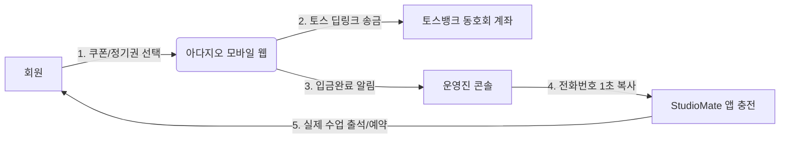

# 📋 아다지오 발레 (Adagio Ballet) 운영 및 기술 인수인계서 (HANDOFF)

> 본 문서는 **아다지오 발레 사내동호회 모바일 웹 포털**을 회사 동료 및 차기 운영진, 개발 담당자에게 원활하게 인수인계(Hand-off)하기 위해 작성되었습니다.

---

## Ⅰ. 시스템 개요 및 운영 목적

### 1. 도입 배경
- 기존 사내 **모자이크(Mosaic) 설문조사 링크**로 정기 수강권 및 1회 쿠폰을 신청받던 방식은 매월 엑셀 취합과 개인 계좌 입금자 대조에 막대한 수작업 시간이 소요되었습니다.
- 본 시스템은 회원들이 모바일에서 **1초 만에 토스 간편송금**으로 결제하고, 운영진은 대기열에서 **전화번호를 복사해 스튜디오메이트(StudioMate)에 즉시 수강권을 충전**할 수 있도록 구축되었습니다.

### 2. 운영 범위 (Phase 1 vs Phase 2)


- **Phase 1 (현재 운영 모델 - 하이브리드)**:
  - 수강권/1회 쿠폰 신청 + 토스 계좌 송금 + 15일 환불 관리: **본 모바일 웹 포털**
  - 실제 주간 수업 예약 / 출석 / 취소 / 보강: **스튜디오메이트(StudioMate) 앱 유지**
- **Phase 2 (향후 완전 전환 로드맵)**:
  - 스튜디오메이트 유료 앱을 해지하고, 본 웹 포털의 [시간표·예약] 엔진으로 완전 통합.

---

## Ⅱ. 운영진(총무/회장) 실무 가이드

### 1. 회원 수강권 신청 및 입금 처리 순서
1. **입금 확인 알림**: 회원이 토스로 송금 후 [입금완료 요청]을 누르면 운영진 화면에 알림이 표시됩니다.
2. **운영진 콘솔 접속**: 상단 우측 **[운영진전환]** 버튼 클릭 → **[입금확인]** 탭으로 이동.
3. **스튜디오메이트 등록**:
   - 신청 내역의 **[번호 복사]** 버튼을 클릭하면 회원의 휴대폰 번호가 클립보드에 복사됩니다.
   - 스튜디오메이트 관리자 앱에서 붙여넣기로 검색 후, 해당 회원의 수강권(Full/Half 4회권 또는 1회권)을 충전합니다.
4. **승인 종결**: **[입금확인 (수강권 즉시 발급)]** 버튼을 누르면 처리가 완료됩니다.

---

### 2. 수강료 및 취소·환불 규정 숙지사항

| 구분 | 종류 | 금액 | 취소/보강 규정 | 환불 규정 |
| :--- | :--- | :--- | :--- | :--- |
| **1회 쿠폰** | Full 80분 (정규/파드되) | **15,000원** | 노쇼 방지를 위해 당일 취소 불가 | **신청 후 환불 불가** (1개월 유효) |
| **1회 쿠폰** | Half 40분 (런치/포인트) | **10,000원** | 노쇼 방지를 위해 당일 취소 불가 | **신청 후 환불 불가** (1개월 유효) |
| **정기권** | Full 4회 / 8회 | **50,000원 / 100,000원** | 4회권은 월 1회, 8회권은 월 2회 가능 | **매월 15일 일괄 환불** |
| **정기권** | Half 4회 / 8회 | **25,000원 / 50,000원** | 4회권은 월 1회, 8회권은 월 2회 가능 | **매월 15일 일괄 환불** |

> ⚠️ **1회 쿠폰 주의사항**:  
> 1회 쿠폰은 강사료 사전 확정 및 노쇼 방지 규정에 따라 **신청 후 환불이 불가**하며, 발급일로부터 **1개월(30일)** 동안 자유롭게 원하는 수업에 사용할 수 있습니다.

---

### 3. 월별 공휴일 및 시간표 변동 관리
- 사내 휴무일이나 대체공휴일로 특정 요일 수업이 휴강되거나 보강이 잡힐 경우:
  1. [운영진 콘솔] → **[휴일설정]** 탭 클릭.
  2. 대상 클래스의 **[상태 변경 설정 →]** 클릭.
  3. 사유 입력 (예: "10/9 한글날 대체공휴일 휴강") 후 **[휴강 처리]** 클릭.
  4. 회원들의 시간표 화면에 분홍색 휴강 뱃지와 함께 예약이 자동 차단됩니다.

---

### 4. 매월 15일 중도 환불 정산 절차
1. 회원이 정기권 잔여 횟수에 대해 환불을 신청하면 [15일환불] 대기열에 등록됩니다.
2. 매월 15일 정산일에 [15일환불] 탭을 열어 은행, 계좌번호, 예금주를 확인합니다.
3. 동호회 계좌에서 해당 금액을 송금한 후 **[송금 완료 및 환불 종결 처리]** 버튼을 누르면 정산이 마감됩니다.

---

## Ⅲ. 개발자(IT 담당자) 기술 인수인계

### 1. 기술 스택 및 아키텍처
- **프레임워크**: Next.js 16.4 (App Router)
- **언어**: TypeScript 5
- **스타일링**: Tailwind CSS v4 (소프트 라일락/세이지그린/캐시미어 팔레트)
- **아이콘**: Lucide React
- **상태 관리**: React Context (`AppContext.tsx`)
- **데이터 저장**: 브라우저 `localStorage` 기반 (별도 DB 설치 없이 즉시 실행 가능)

### 2. 주요 파일 및 디렉토리 설명
```
src/
├── types/index.ts            # 전체 데이터 모델 (User, TicketType, ClassSession, Booking, PaymentRequest, RefundRequest)
├── data/mockData.ts          # 스튜디오메이트 실제 시간표 원본, 수강권 가격표, 계좌정보 (수정 시 여기 변경)
├── context/AppContext.tsx    # 핵심 비즈니스 로직 (수강권 차감, 대기열 자동 승급, 취소 한도 체크, 환불 차단 로직)
└── components/
    ├── TicketsTab.tsx        # 수강권/1회권 신청 카탈로그, 보유권 카드, 규정 안내
    ├── ScheduleTab.tsx       # 주차별 요일 시간표, 파드되 80분 Full 클래스 표기, 예약/취소
    ├── AdminTab.tsx          # 입금 승인, 번호 복사, 출석부 복사, 휴일설정, 15일환불
    ├── TossPaymentModal.tsx  # 토스 앱 딥링크 호출 (supertoss://send?bank=...)
    └── RefundModal.tsx       # 환불 계좌 입력 및 1회권 환불 차단 처리
```

---

### 3. 주요 비즈니스 로직 위치

#### ① 1회 쿠폰 환불 차단 로직 (`src/context/AppContext.tsx`)
```typescript
const requestRefund = (ticketId: string, ...) => {
  const ticket = userTickets.find((t) => t.id === ticketId);
  const tType = ticketTypes.find((t) => t.id === ticket.ticketTypeId);
  
  // 1회 쿠폰 환불 불가 규정 강제
  if (tType?.category === 'coupon' || ticket.title.includes('1회')) {
    return {
      success: false,
      message: '동호회 회칙상 1회 쿠폰은 구매 후 환불이 불가합니다. (발급일로부터 30일간 유효)',
    };
  }
  // 정기권 잔여 횟수 비례 환불 금액 산출...
};
```

#### ② 정원 마감 시 자동 대기 및 취소 시 자동 승급 로직 (`src/context/AppContext.tsx`)
- 수업 정원(파드되 5명, 일반 14명) 초과 시 자동으로 `status: 'waitlist'`, `waitlistNumber: N`으로 접수.
- 기존 확정자가 예약을 취소하면 대기 1번 회원이 자동으로 확정(`status: 'confirmed'`)으로 승급되고 수강권 1회가 자동 차단/연동됩니다.

---

### 4. Phase 2 백엔드 DB 연동 가이드 (선택 사항)

현재는 빠른 PoC 및 사내 동호회 편의를 위해 `localStorage`로 동작하지만, 영구 백엔드가 필요할 경우 아래와 같이 쉽게 확장할 수 있습니다:

1. **Supabase / Firebase 연동**:
   - `src/context/AppContext.tsx` 내의 `localStorage.getItem/setItem` 부분을 Supabase 클라이언트 호출(`supabase.from('bookings').select()`)로 1:1 교체 가능하도록 구조화되어 있습니다.
2. **사내 SSO / 사번 연동**:
   - `src/types/index.ts`의 `User` 인터페이스에 `employeeId(사번)` 필드를 추가하고 사내 포털 OAuth와 연동할 수 있습니다.
3. **토스페이먼츠(Toss Payments) 자동 결제**:
   - 현재는 토스 딥링크 송금 방식이지만, 향후 동호회 사업자등록증이 생기면 토스페이먼츠 PG SDK를 연동하여 카드 결제 및 입금 자동 통보 웹훅(Webhook)을 붙일 수 있습니다.

---

## Ⅳ. 유지보수 및 문의처

- **GitHub 저장소**: [https://github.com/mismira96-stack/AdagioBallet](https://github.com/mismira96-stack/AdagioBallet)
- **공식 문의 이메일**: `adagio.ballet@company.com`
- **동호회 공식 계좌**: 토스뱅크 1000-2468-1357 (예금주: 아다지오)
